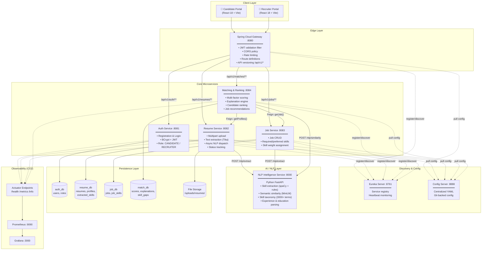
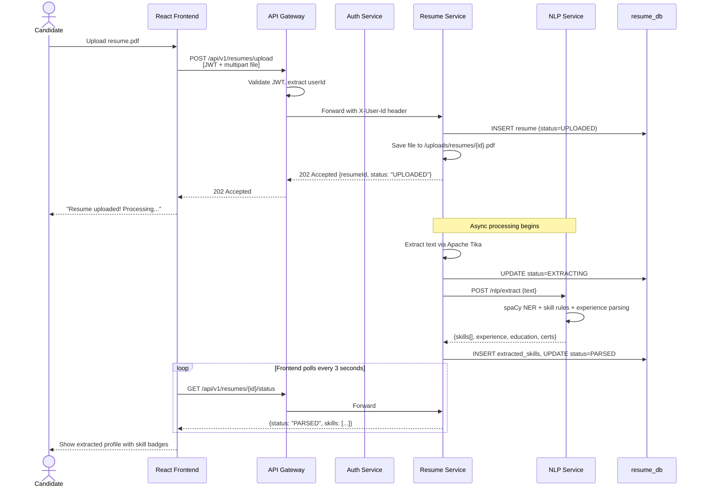
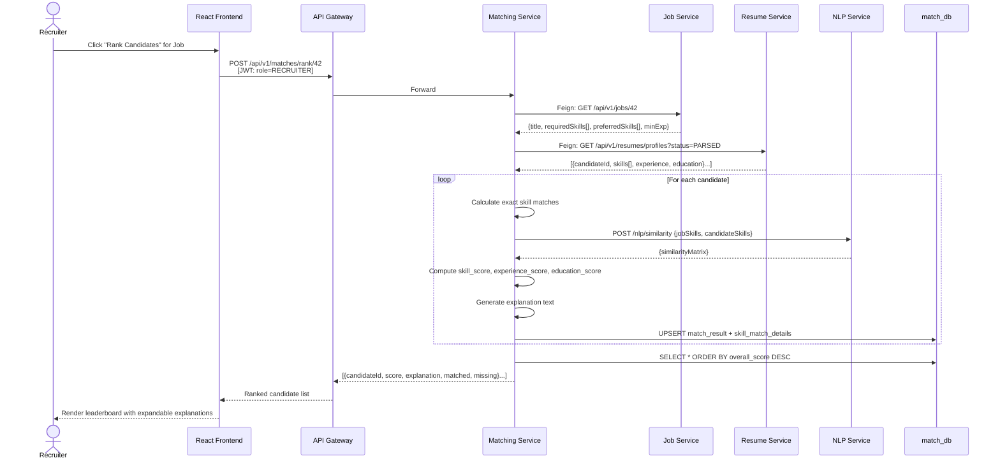
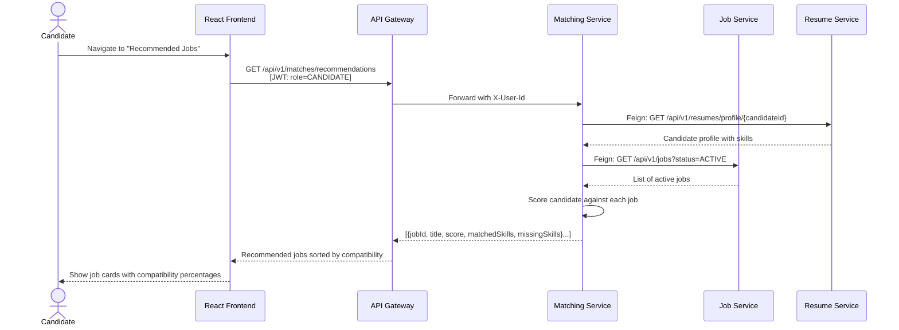
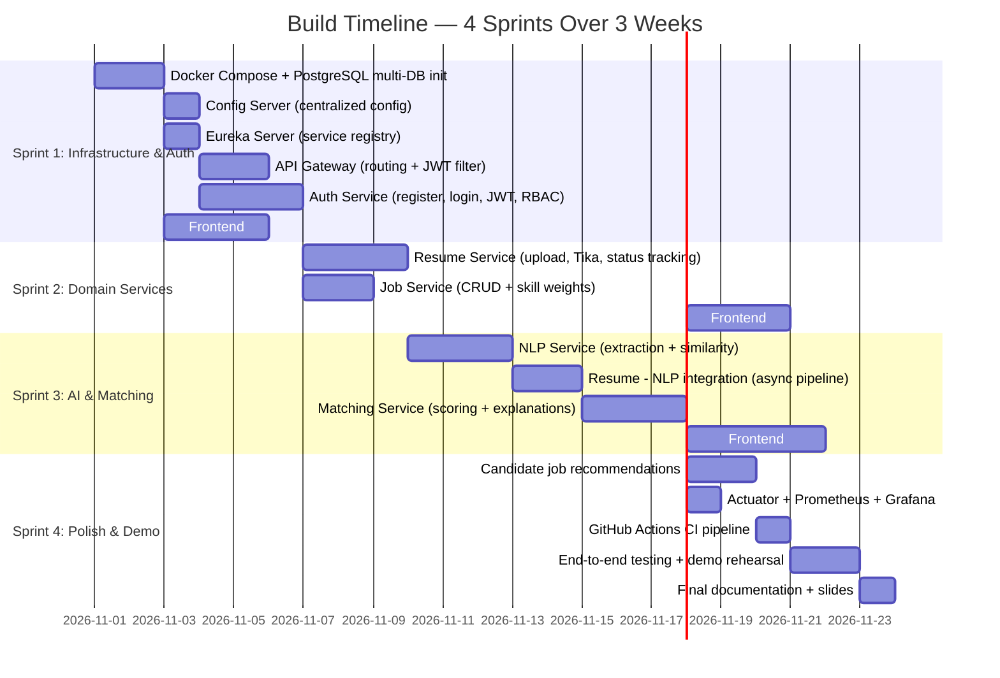

# AI-Powered Skill Matching Recruitment System

## Definitive Architecture & Implementation Blueprint

**Course:** Service-Oriented Architecture (SOA) — Review-2  
**Institution:** KLH CSE Bowrampet Campus, KL University  
**Guide:** Dr. Neelima Gogineni, Associate Professor, Department of CSE  
**Project Team (Batch 17):**

- **K. Nikhil Sai** — 2420030635
- **Santosh** — 2420030198
- **Pranav Itharaju** — 2420030538

---

## 1. What This System Actually Solves

Recruiters screen hundreds of resumes per job opening. The industry standard — Applicant Tracking Systems (ATS) — relies on **exact keyword matching**: if the job says "Kubernetes" and the resume says "K8s", the candidate is silently rejected. This is a broken model.

Our system replaces that with:

1. **Structured extraction** — parse unstructured resumes into machine-readable candidate profiles (skills, experience, education, projects, certifications).
2. **Semantic understanding** — "K8s" ≈ "Kubernetes", "Postgres" ≈ "PostgreSQL", "React Native" ≠ "React.js". The system understands these distinctions.
3. **Explainable scoring** — every match score comes with a full breakdown: what matched, what was semantically close, what's missing, and why the final number is what it is. No black boxes.
4. **Instant ranking** — recruiters get a sorted leaderboard of candidates with one click.

---

## 2. Architecture Philosophy: What We Changed and Why

### Decisions from the previous plan that we KEPT

| Decision | Rationale |
|---|---|
| **Spring Cloud Gateway as edge** | Single entry point, centralized JWT filter, CORS — this is the right call for SOA |
| **Eureka for service discovery** | Required for CO3, proven Spring Cloud integration, avoids hardcoded ports |
| **Database-per-service** | Core microservices principle, enforces loose coupling, directly addresses CO1 |
| **Python for NLP** | The ML ecosystem (spaCy, sentence-transformers, scikit-learn) lives in Python. Fighting this with Java would be engineering malpractice |
| **OpenFeign for inter-service calls** | Declarative, clean, integrates with Eureka load balancing |
| **Explainable scoring** | The single most important differentiator — this is what makes the project academically defensible AND commercially viable |

### Decisions from the previous plan that we REMOVED

| Removed | Why |
|---|---|
| **Notification Service** | A separate microservice that sends emails/SMS adds zero value to the core matching workflow. It's scope creep. If notifications are needed later, they're a 50-line module inside an existing service, not a separate deployment |
| **MinIO / Object Storage** | Overengineered for resume files. Local filesystem with a clean directory convention works perfectly for demos AND early production. MinIO adds operational complexity with zero user-facing benefit |
| **Kubernetes references** | You're 3 students building a demo. Docker Compose is the correct deployment target. Mentioning K8s in the architecture without actually using it weakens credibility |
| **Blind Screening toggle** | Sounds impressive in a slide but is trivially implemented (just omit fields from the API response). It's not an architectural feature — it's a UI checkbox. Listing it as a headline feature inflates the plan |
| **Resilience4j as a headline feature** | Circuit breaking is a 3-line annotation on a Feign client. It should be a default engineering practice, not a selling point. We'll use it, but we won't pretend it's an innovation |
| **Separate Scoring & Ranking Service** | The original slides listed 6 backend services (Auth, Resume, Job, NLP, Semantic Matching, Scoring & Ranking). That's too many services for the scope. Matching + Scoring + Ranking is ONE bounded context — splitting it creates unnecessary network calls with no isolation benefit |

### Decisions we ADDED

| Added | Why |
|---|---|
| **Async resume processing pipeline** | Resume parsing + NLP extraction is slow (2-8 seconds). Blocking the HTTP request while this happens is terrible UX. The new architecture accepts the upload immediately, processes asynchronously, and lets the frontend poll for status |
| **Skill Taxonomy Service (inside NLP)** | A curated, versioned taxonomy of 3,000+ technology skills with synonym mappings and category hierarchies. This is what separates a toy demo from a real product |
| **Match explanation engine** | Not just a score — a structured narrative explaining each dimension: "Candidate has 4/5 required hard skills, semantically matches 1 more via Docker→Container Orchestration, missing AWS. Experience exceeds minimum by 1.5 years." |
| **Candidate-side job recommendations** | The matching engine works bidirectionally: recruiters see ranked candidates, AND candidates see ranked jobs they're compatible with. This doubles the system's value with minimal extra code |
| **API versioning from day one** | All routes are `/api/v1/...`. When you inevitably need to change a contract, you don't break existing consumers |
| **Centralized config via Spring Cloud Config** | All service configurations (DB URLs, JWT secrets, NLP endpoints) live in one Git-backed config repo. No more scattered `application.yml` files with duplicated secrets |

---

## 3. The Architecture

### 3.1 High-Level System Diagram



### 3.2 Service Communication Matrix

This table shows exactly which service calls which, and how. Every arrow in the diagram above is documented here.

| Caller | Callee | Protocol | Endpoint | Purpose | Failure Strategy |
|---|---|---|---|---|---|
| Gateway | Auth | HTTP via Eureka | `POST /api/v1/auth/login` | Forward auth requests | 503 to client |
| Gateway | Resume | HTTP via Eureka | `POST /api/v1/resumes/upload` | Forward uploads | 503 to client |
| Gateway | Job | HTTP via Eureka | `GET /api/v1/jobs` | Forward job queries | 503 to client |
| Gateway | Match | HTTP via Eureka | `GET /api/v1/matches/rankings/{jobId}` | Forward ranking requests | 503 to client |
| Resume | NLP | HTTP direct | `POST :8000/nlp/extract` | Extract skills from resume text | Retry 2x, then mark resume `FAILED` |
| Job | NLP | HTTP direct | `POST :8000/nlp/extract` | Normalize job skill descriptions | Retry 2x, then store raw skills |
| Match | Job | OpenFeign + Eureka | `GET /api/v1/jobs/{id}` | Fetch job requirements | Circuit breaker, return cached if available |
| Match | Resume | OpenFeign + Eureka | `GET /api/v1/resumes/profiles` | Fetch parsed candidate profiles | Circuit breaker, partial results |
| Match | NLP | HTTP direct | `POST :8000/nlp/similarity` | Compute semantic distances | Fallback to exact-match-only scoring |

---

## 4. Data Architecture

### 4.1 Entity Relationship Diagrams

#### auth_db

```
┌─────────────────────────────┐
│           users             │
├─────────────────────────────┤
│ id          UUID PK         │
│ email       VARCHAR UNIQUE  │
│ password    VARCHAR (BCrypt) │
│ full_name   VARCHAR         │
│ role        ENUM            │
│             (CANDIDATE,     │
│              RECRUITER)     │
│ created_at  TIMESTAMP       │
│ updated_at  TIMESTAMP       │
└─────────────────────────────┘
```

#### resume_db

```
┌──────────────────────────────┐      ┌──────────────────────────────┐
│          resumes             │      │      extracted_skills        │
├──────────────────────────────┤      ├──────────────────────────────┤
│ id           UUID PK         │──┐   │ id            UUID PK        │
│ candidate_id UUID (from JWT) │  │   │ resume_id     UUID FK        │
│ original_filename VARCHAR    │  │   │ skill_name    VARCHAR        │
│ file_path    VARCHAR         │  │   │ skill_category VARCHAR       │
│ file_size    BIGINT          │  │   │ proficiency   VARCHAR        │
│ content_type VARCHAR         │  │   │ source_context TEXT          │
│ extracted_text TEXT          │  │   │ confidence    FLOAT          │
│ experience_years FLOAT      │  │   └──────────────────────────────┘
│ education    JSONB           │  │
│ certifications JSONB         │  │   ┌──────────────────────────────┐
│ projects     JSONB           │  │   │     candidate_profiles       │
│ status       ENUM            │  │   ├──────────────────────────────┤
│   (UPLOADED, EXTRACTING,     │  └──>│ id            UUID PK        │
│    PARSED, FAILED)           │      │ resume_id     UUID FK        │
│ error_message TEXT           │      │ candidate_id  UUID           │
│ created_at   TIMESTAMP       │      │ summary_text  TEXT           │
│ parsed_at    TIMESTAMP       │      │ skill_vector  JSONB          │
└──────────────────────────────┘      │ total_skills  INT            │
                                      │ created_at    TIMESTAMP      │
                                      └──────────────────────────────┘
```

#### job_db

```
┌──────────────────────────────┐      ┌──────────────────────────────┐
│         job_postings         │      │        job_skills            │
├──────────────────────────────┤      ├──────────────────────────────┤
│ id           UUID PK         │──┐   │ id            UUID PK        │
│ recruiter_id UUID (from JWT) │  │   │ job_id        UUID FK        │
│ title        VARCHAR         │  │   │ skill_name    VARCHAR        │
│ department   VARCHAR         │  │   │ category      VARCHAR        │
│ description  TEXT            │  │   │ is_mandatory  BOOLEAN        │
│ location     VARCHAR         │  │   │ weight        FLOAT (0-1)    │
│ min_experience_years FLOAT   │  └──>│ created_at    TIMESTAMP      │
│ status       ENUM            │      └──────────────────────────────┘
│   (DRAFT, ACTIVE, CLOSED)    │
│ created_at   TIMESTAMP       │
│ updated_at   TIMESTAMP       │
└──────────────────────────────┘
```

#### match_db

```
┌──────────────────────────────────┐      ┌─────────────────────────────────┐
│         match_results            │      │       skill_match_details       │
├──────────────────────────────────┤      ├─────────────────────────────────┤
│ id              UUID PK          │──┐   │ id               UUID PK       │
│ job_id          UUID             │  │   │ match_result_id  UUID FK       │
│ candidate_id    UUID             │  │   │ required_skill   VARCHAR       │
│ overall_score   FLOAT (0-100)    │  │   │ match_type       ENUM          │
│ skill_score     FLOAT (0-100)    │  │   │   (EXACT, SEMANTIC, MISSING)   │
│ experience_score FLOAT (0-100)   │  │   │ candidate_skill  VARCHAR NULL  │
│ education_score FLOAT (0-100)    │  └──>│ similarity_score FLOAT         │
│ explanation     TEXT             │      │ explanation      TEXT           │
│ matched_count   INT              │      └─────────────────────────────────┘
│ missing_count   INT              │
│ calculated_at   TIMESTAMP        │
│ UNIQUE(job_id, candidate_id)     │
└──────────────────────────────────┘
```

### 4.2 Data Isolation Rules

- Services **NEVER** query another service's database directly.
- All cross-service data access goes through REST APIs (via OpenFeign or HTTP client).
- Each service uses its own JPA `EntityManager` and connection pool.
- In Docker Compose, one PostgreSQL container runs all 4 databases — this is fine for a demo and even for early production. The isolation is logical, not physical.

---

## 5. The Scoring Engine — The Core Innovation

This is the heart of the system. Everything else is plumbing; this is the product.

### 5.1 Multi-Factor Scoring Formula

```
Overall Score = (W1 x Skill Score) + (W2 x Experience Score) + (W3 x Education Score)

Where default weights:
  W1 = 0.60  (skills are king)
  W2 = 0.25  (experience matters but isn't everything)
  W3 = 0.15  (education/certifications as tiebreaker)
```

### 5.2 Skill Score Calculation

```
For each required skill in the job:
  1. Check EXACT match against candidate skills -> score = 1.0
  2. If no exact match, check SEMANTIC similarity via NLP service
     -> if similarity > 0.80 threshold -> score = similarity_value
     -> if similarity <= 0.80 -> score = 0.0 (skill is "missing")
  3. Weight each skill by its job_skills.weight (mandatory skills weight more)

Skill Score = (Sum of weighted_skill_scores / Sum of max_possible_weighted_scores) x 100
```

### 5.3 Experience Score Calculation

```
If candidate_years >= required_years:
  Experience Score = 100
Else:
  Experience Score = (candidate_years / required_years) x 100

Cap at 100 — having 10 years when 3 are required doesn't score 333%.
```

### 5.4 Explanation Generation

Every match result includes a human-readable explanation:

```
"John scored 85.2% for Senior Java Developer.
 ✅ Exact matches: Java, Spring Boot, PostgreSQL, Docker (4/6 required skills)
 🔵 Semantic match: K8s → Kubernetes (similarity: 0.96)
 ❌ Missing: Apache Kafka
 📊 Experience: 4.5 years (exceeds 3.0 year minimum)
 🎓 Education: B.Tech CS (meets requirement)"
```

This is what makes the system **explainable** — not a black box.

---

## 6. Request Flow Deep Dives

### Flow 1: Resume Upload & Async Processing



### Flow 2: Recruiter Triggers Candidate Ranking



### Flow 3: Candidate Views Job Recommendations



---

## 7. Complete API Contracts

### 7.1 Auth Service (`:8081`)

| Method | Endpoint | Auth | Request Body | Response |
|---|---|---|---|---|
| `POST` | `/api/v1/auth/register` | Public | `{fullName, email, password, role}` | `201 {userId, email, role}` |
| `POST` | `/api/v1/auth/login` | Public | `{email, password}` | `200 {token, userId, role, expiresIn}` |
| `GET` | `/api/v1/auth/me` | Bearer JWT | — | `200 {userId, email, fullName, role}` |
| `POST` | `/api/v1/auth/validate` | Service-to-Service | `{token}` | `200 {valid, userId, role}` |

### 7.2 Resume Service (`:8082`)

| Method | Endpoint | Auth | Description |
|---|---|---|---|
| `POST` | `/api/v1/resumes/upload` | `CANDIDATE` | Multipart file upload. Returns `202 {resumeId, status}` |
| `GET` | `/api/v1/resumes/{id}/status` | `CANDIDATE` | Poll processing status: `UPLOADED -> EXTRACTING -> PARSED / FAILED` |
| `GET` | `/api/v1/resumes/my-profile` | `CANDIDATE` | Returns extracted profile, skills, experience for the logged-in candidate |
| `GET` | `/api/v1/resumes/profiles` | Internal (Feign) | Returns all parsed candidate profiles for matching |
| `GET` | `/api/v1/resumes/profile/{candidateId}` | Internal (Feign) | Returns single candidate profile by ID |

### 7.3 Job Service (`:8083`)

| Method | Endpoint | Auth | Description |
|---|---|---|---|
| `POST` | `/api/v1/jobs` | `RECRUITER` | Create job posting with required/preferred skills and weights |
| `GET` | `/api/v1/jobs` | Authenticated | List all active jobs (candidates browse, recruiters manage) |
| `GET` | `/api/v1/jobs/{id}` | Authenticated | Get full job details including skill requirements |
| `PUT` | `/api/v1/jobs/{id}` | `RECRUITER` (owner) | Update job posting |
| `PATCH` | `/api/v1/jobs/{id}/status` | `RECRUITER` (owner) | Change status: `DRAFT -> ACTIVE -> CLOSED` |
| `DELETE` | `/api/v1/jobs/{id}` | `RECRUITER` (owner) | Soft-delete job posting |

### 7.4 NLP Intelligence Service (`:8000`)

| Method | Endpoint | Auth | Description |
|---|---|---|---|
| `POST` | `/nlp/extract` | Internal | Accepts raw text, returns `{skills[], experienceYears, education[], certifications[], projects[]}` |
| `POST` | `/nlp/similarity` | Internal | Accepts `{sourceSkills[], targetSkills[]}`, returns pairwise similarity matrix with scores |
| `GET` | `/nlp/taxonomy` | Internal | Returns the full skill taxonomy (for debugging/admin) |
| `GET` | `/nlp/health` | Public | Health check for the Python service |

### 7.5 Matching & Ranking Service (`:8084`)

| Method | Endpoint | Auth | Description |
|---|---|---|---|
| `POST` | `/api/v1/matches/rank/{jobId}` | `RECRUITER` | Trigger scoring of all parsed candidates against a specific job |
| `GET` | `/api/v1/matches/rankings/{jobId}` | `RECRUITER` | Get ranked leaderboard with full explanations |
| `GET` | `/api/v1/matches/rankings/{jobId}/{candidateId}` | `RECRUITER` | Get detailed match breakdown for one candidate |
| `GET` | `/api/v1/matches/recommendations` | `CANDIDATE` | Get job recommendations for the logged-in candidate |
| `GET` | `/api/v1/matches/history` | `CANDIDATE` | Get all match scores where this candidate was evaluated |

---

## 8. NLP Service — Technical Deep Dive

This is the most technically interesting service. Here's exactly how it works.

### 8.1 Skill Extraction Pipeline

```
Raw Resume Text
      |
      v
+---------------------+
|  1. Text Cleanup     |  Remove headers/footers, normalize unicode, fix OCR artifacts
+----------+----------+
           |
           v
+---------------------+
|  2. Section Splitter |  Identify sections: EXPERIENCE, EDUCATION, SKILLS, PROJECTS, CERTIFICATIONS
+----------+----------+
           |
           v
+-----------------------------------------+
|  3. Dual Extraction Strategy             |
|                                          |
|  A) Rule-based EntityRuler (spaCy)       |
|     - 3,000+ curated tech terms          |
|     - Pattern: "Spring Boot" -> SKILL    |
|     - Pattern: "5 years" -> EXPERIENCE   |
|     - Fast, deterministic, high precision|
|                                          |
|  B) NER model (spaCy en_core_web_sm)     |
|     - Catches entities rules miss        |
|     - Lower precision, higher recall     |
|                                          |
|  Union of both -> deduplicated skill list|
+----------+------------------------------+
           |
           v
+---------------------+
|  4. Skill Normalizer |  "ReactJS" -> "React", "Postgres" -> "PostgreSQL", "k8s" -> "Kubernetes"
+----------+----------+
           |
           v
+---------------------+
|  5. Category Tagger  |  Each skill gets a category: LANGUAGE, FRAMEWORK, DATABASE, CLOUD, TOOL, SOFT_SKILL
+----------+----------+
           |
           v
  Structured Output JSON
```

### 8.2 Semantic Similarity Engine

```python
# Core idea: convert skills to vectors, compare with cosine similarity
from sentence_transformers import SentenceTransformer

model = SentenceTransformer('all-MiniLM-L6-v2')  # 80MB, runs on CPU

def compute_similarity(job_skills: list[str], candidate_skills: list[str]) -> dict:
    job_embeddings = model.encode(job_skills)
    candidate_embeddings = model.encode(candidate_skills)

    # For each job skill, find the best matching candidate skill
    results = {}
    for i, job_skill in enumerate(job_skills):
        best_score = 0.0
        best_match = None
        for j, cand_skill in enumerate(candidate_skills):
            score = cosine_similarity(job_embeddings[i], candidate_embeddings[j])
            if score > best_score:
                best_score = score
                best_match = cand_skill
        results[job_skill] = {"matchedWith": best_match, "score": round(best_score, 4)}

    return results
```

### 8.3 Skill Taxonomy Sample

```json
{
  "kubernetes": {
    "canonical": "Kubernetes",
    "aliases": ["k8s", "kube", "kubernetes cluster"],
    "category": "CONTAINER_ORCHESTRATION",
    "related": ["Docker", "Container", "Helm", "EKS", "GKE", "AKS"]
  },
  "react": {
    "canonical": "React",
    "aliases": ["reactjs", "react.js", "react js"],
    "category": "FRONTEND_FRAMEWORK",
    "related": ["Next.js", "Redux", "JSX", "Virtual DOM"]
  },
  "postgresql": {
    "canonical": "PostgreSQL",
    "aliases": ["postgres", "psql", "pg"],
    "category": "DATABASE",
    "related": ["SQL", "Relational Database", "PL/pgSQL"]
  }
}
```

---

## 9. Frontend Architecture

### 9.1 Page Map & User Flows

```
PUBLIC ROUTES
├── /login                    -> Login form (email + password)
├── /register                 -> Registration form (name + email + password + role selector)
└── /                         -> Landing page / redirect to dashboard

CANDIDATE ROUTES (requires JWT with role=CANDIDATE)
├── /candidate/dashboard      -> Overview: profile status, recent matches
├── /candidate/upload         -> Drag-and-drop resume upload + processing status tracker
├── /candidate/profile        -> View extracted skills, experience, education (editable later)
├── /candidate/jobs           -> Browse active job listings with compatibility scores
└── /candidate/matches        -> View all match results and detailed breakdowns

RECRUITER ROUTES (requires JWT with role=RECRUITER)
├── /recruiter/dashboard      -> Overview: active jobs, total candidates, recent rankings
├── /recruiter/jobs           -> Job management table (create, edit, close)
├── /recruiter/jobs/new       -> Create job form with skill tag input + weight sliders
├── /recruiter/jobs/:id       -> Job detail with "Rank Candidates" trigger button
└── /recruiter/rankings/:id   -> Candidate leaderboard with expandable explanation cards
```

### 9.2 Key UI Components

| Component | Purpose |
|---|---|
| `<SkillBadge type="matched/semantic/missing">` | Color-coded skill pills used across all views |
| `<ScoreGauge score={85.2}>` | Animated circular gauge showing overall compatibility |
| `<ScoreBreakdown>` | Expandable card showing skill/experience/education sub-scores |
| `<ResumeDropzone>` | Drag-and-drop file upload with progress bar and status polling |
| `<CandidateRankingTable>` | Sortable table with inline score bars and "View Details" drawers |
| `<SkillTagInput>` | Autocomplete skill input for job creation (suggests from taxonomy) |
| `<ProcessingTracker status={...}>` | Step indicator: Upload -> Extracting -> Parsed |

---

## 10. Technology Stack — Final Decisions

| Layer | Technology | Version | Justification |
|---|---|---|---|
| **Frontend** | React 18 + Vite | 18.x / 5.x | Fast dev server, modern JSX, industry standard |
| **Frontend Styling** | CSS Modules or Vanilla CSS | — | No external CSS framework dependency |
| **Frontend HTTP** | Axios | 1.x | Clean interceptors for JWT attachment |
| **Frontend Routing** | React Router | 6.x | Declarative routing with protected route wrappers |
| **API Gateway** | Spring Cloud Gateway | 4.x | Reactive, non-blocking, Eureka integration |
| **Service Registry** | Spring Cloud Netflix Eureka | 4.x | Mature, battle-tested, required for CO3 |
| **Config Server** | Spring Cloud Config | 4.x | Centralized configuration, Git-backed |
| **Auth** | Spring Security 6 + jjwt | 6.x / 0.12.x | Industry standard JWT with BCrypt |
| **Business Services** | Spring Boot 3 | 3.3.x | JPA, Web, Actuator, OpenFeign |
| **Inter-Service** | Spring Cloud OpenFeign | 4.x | Declarative REST client with Eureka LB |
| **Resilience** | Resilience4j | 2.x | Circuit breaker on Feign clients (3-line config) |
| **Java Build** | Maven | 3.9.x | Standard, well-supported |
| **Java Runtime** | JDK 17 | 17 LTS | Required by Spring Boot 3 |
| **NLP Runtime** | Python 3.10+ | 3.10+ | Required for spaCy and sentence-transformers |
| **NLP Framework** | FastAPI + Uvicorn | 0.110+ | Async, auto-documented (Swagger), fast |
| **NLP Models** | spaCy en_core_web_sm + all-MiniLM-L6-v2 | — | Small enough to run on a laptop, powerful enough to be useful |
| **Text Extraction** | Apache Tika (Java) | 2.x | Handles PDF, DOCX, and 1000+ formats |
| **Database** | PostgreSQL | 16 | JSONB support for flexible extraction storage |
| **Containerization** | Docker + Docker Compose | — | Single-command local deployment |
| **CI/CD** | GitHub Actions | — | Free for public repos, YAML-based |
| **Observability** | Actuator + Micrometer + Prometheus + Grafana | — | Production-grade metrics stack |

---

## 11. Project Directory Structure

```text
recruitment-system/
│
├── docker-compose.yml                  # Entire system in one command
├── init-scripts/
│   └── 01-create-databases.sql         # Creates auth_db, resume_db, job_db, match_db
├── .github/workflows/
│   └── ci.yml                          # Build + test all services
├── README.md                           # Setup guide and demo walkthrough
│
├── config-server/                      # Spring Cloud Config Server (:8888)
│   ├── pom.xml
│   └── src/main/java/.../ConfigServerApplication.java
│
├── eureka-server/                      # Service Registry (:8761)
│   ├── pom.xml
│   └── src/main/java/.../EurekaServerApplication.java
│
├── api-gateway/                        # Spring Cloud Gateway (:8080)
│   ├── pom.xml
│   └── src/main/java/.../
│       ├── ApiGatewayApplication.java
│       ├── filter/JwtAuthenticationFilter.java
│       └── config/RouteConfig.java
│
├── auth-service/                       # Authentication & Authorization (:8081)
│   ├── pom.xml
│   ├── Dockerfile
│   └── src/main/java/.../
│       ├── AuthServiceApplication.java
│       ├── controller/AuthController.java
│       ├── service/AuthService.java
│       ├── service/JwtService.java
│       ├── model/User.java
│       ├── dto/LoginRequest.java
│       ├── dto/RegisterRequest.java
│       ├── dto/AuthResponse.java
│       ├── repository/UserRepository.java
│       └── config/SecurityConfig.java
│
├── resume-service/                     # Resume Upload & Processing (:8082)
│   ├── pom.xml
│   ├── Dockerfile
│   └── src/main/java/.../
│       ├── ResumeServiceApplication.java
│       ├── controller/ResumeController.java
│       ├── service/ResumeService.java
│       ├── service/TextExtractionService.java
│       ├── client/NlpServiceClient.java
│       ├── model/Resume.java
│       ├── model/ExtractedSkill.java
│       ├── model/CandidateProfile.java
│       ├── dto/ResumeStatusResponse.java
│       ├── dto/NlpExtractionResponse.java
│       └── repository/ResumeRepository.java
│
├── job-service/                        # Job Description Management (:8083)
│   ├── pom.xml
│   ├── Dockerfile
│   └── src/main/java/.../
│       ├── JobServiceApplication.java
│       ├── controller/JobController.java
│       ├── service/JobService.java
│       ├── client/NlpServiceClient.java
│       ├── model/JobPosting.java
│       ├── model/JobSkill.java
│       ├── dto/CreateJobRequest.java
│       ├── dto/JobResponse.java
│       └── repository/JobRepository.java
│
├── matching-service/                   # Scoring, Ranking & Recommendations (:8084)
│   ├── pom.xml
│   ├── Dockerfile
│   └── src/main/java/.../
│       ├── MatchingServiceApplication.java
│       ├── controller/MatchController.java
│       ├── service/MatchingService.java
│       ├── service/ScoringEngine.java
│       ├── service/ExplanationGenerator.java
│       ├── client/JobServiceClient.java
│       ├── client/ResumeServiceClient.java
│       ├── client/NlpServiceClient.java
│       ├── model/MatchResult.java
│       ├── model/SkillMatchDetail.java
│       ├── dto/RankingResponse.java
│       ├── dto/MatchBreakdownResponse.java
│       └── repository/MatchResultRepository.java
│
├── nlp-service/                        # Python AI Intelligence (:8000)
│   ├── requirements.txt
│   ├── Dockerfile
│   ├── tests/
│   │   ├── test_extractor.py
│   │   └── test_similarity.py
│   └── app/
│       ├── main.py                     # FastAPI app + health endpoint
│       ├── extractor.py                # Skill extraction pipeline
│       ├── similarity.py               # Semantic similarity engine
│       ├── taxonomy.py                 # Skill taxonomy with synonyms & categories
│       └── models.py                   # Pydantic request/response schemas
│
└── frontend/                           # React 18 + Vite (:5173)
    ├── package.json
    ├── vite.config.js
    ├── index.html
    └── src/
        ├── App.jsx
        ├── main.jsx
        ├── index.css                   # Global design system
        ├── components/
        │   ├── SkillBadge.jsx
        │   ├── ScoreGauge.jsx
        │   ├── ScoreBreakdown.jsx
        │   ├── ResumeDropzone.jsx
        │   ├── CandidateRankingTable.jsx
        │   ├── SkillTagInput.jsx
        │   ├── ProcessingTracker.jsx
        │   ├── Navbar.jsx
        │   └── ProtectedRoute.jsx
        ├── pages/
        │   ├── Login.jsx
        │   ├── Register.jsx
        │   ├── candidate/
        │   │   ├── Dashboard.jsx
        │   │   ├── Upload.jsx
        │   │   ├── Profile.jsx
        │   │   ├── Jobs.jsx
        │   │   └── Matches.jsx
        │   └── recruiter/
        │       ├── Dashboard.jsx
        │       ├── JobList.jsx
        │       ├── CreateJob.jsx
        │       ├── JobDetail.jsx
        │       └── CandidateRankings.jsx
        └── services/
            ├── api.js                  # Axios instance with JWT interceptor
            ├── authService.js
            ├── resumeService.js
            ├── jobService.js
            └── matchService.js
```

---

## 12. Implementation Roadmap



---

## 13. Docker Compose — Complete Orchestration

```yaml
# docker-compose.yml (reference structure)
version: "3.9"

services:
  postgres:
    image: postgres:16-alpine
    ports: ["5432:5432"]
    environment:
      POSTGRES_USER: recruitment
      POSTGRES_PASSWORD: recruitment_pass
    volumes:
      - ./init-scripts:/docker-entrypoint-initdb.d
      - pgdata:/var/lib/postgresql/data

  config-server:
    build: ./config-server
    ports: ["8888:8888"]

  eureka-server:
    build: ./eureka-server
    ports: ["8761:8761"]
    depends_on: [config-server]

  api-gateway:
    build: ./api-gateway
    ports: ["8080:8080"]
    depends_on: [eureka-server]

  auth-service:
    build: ./auth-service
    ports: ["8081:8081"]
    depends_on: [postgres, eureka-server]

  resume-service:
    build: ./resume-service
    ports: ["8082:8082"]
    volumes: ["./uploads:/uploads"]
    depends_on: [postgres, eureka-server, nlp-service]

  job-service:
    build: ./job-service
    ports: ["8083:8083"]
    depends_on: [postgres, eureka-server]

  matching-service:
    build: ./matching-service
    ports: ["8084:8084"]
    depends_on: [postgres, eureka-server, nlp-service]

  nlp-service:
    build: ./nlp-service
    ports: ["8000:8000"]

  frontend:
    build: ./frontend
    ports: ["5173:5173"]
    depends_on: [api-gateway]

  prometheus:
    image: prom/prometheus:latest
    ports: ["9090:9090"]
    volumes: ["./monitoring/prometheus.yml:/etc/prometheus/prometheus.yml"]

  grafana:
    image: grafana/grafana:latest
    ports: ["3000:3000"]
    depends_on: [prometheus]

volumes:
  pgdata:
```

---

## 14. Course Outcomes Mapping — Final Summary

| CO | Where It Lives | Evidence for Reviewers |
|---|---|---|
| **CO1: Architecture & Service Design** | 6 independently deployable services, each with its own database, API boundary, and bounded context. Config Server for centralized management. | Show Eureka dashboard with all services registered. Show that stopping Resume Service doesn't crash Job Service. |
| **CO2: Security & Observability** | JWT issued by Auth, validated centrally at Gateway, propagated as headers. Actuator /health, /metrics. Prometheus scraping. Grafana dashboard. | Demo login -> JWT -> protected endpoint. Open Grafana showing live request rates and JVM metrics. |
| **CO3: Discovery, Routing & Data** | Eureka registry, Gateway route table, OpenFeign client-side load balancing, database-per-service with no cross-DB joins. | Show Gateway routes in application.yml. Show OpenFeign interfaces. Show 4 separate DBs in psql. |
| **CO4: Testing, CI/CD & Demo** | JUnit + MockMvc tests for Java, PyTest for NLP, GitHub Actions pipeline, Docker Compose one-command startup. | Run `docker-compose up`, walk through both user journeys end-to-end in under 5 minutes. |

---

## 15. Review-2 Viva Defense Guide

**Q: "Why not use a single monolithic application?"**
A: A monolith would make it impossible to demonstrate service discovery, API gateway routing, independent deployment, or per-service databases — which are all core SOA concepts. Additionally, the NLP service benefits from Python's ML ecosystem while business logic benefits from Spring Boot's enterprise features — a polyglot architecture that a monolith cannot support.

**Q: "Can the Matching Service work if the NLP Service is down?"**
A: Yes, with degraded functionality. The circuit breaker falls back to exact-match-only scoring (no semantic similarity). The score will be lower quality but the system remains operational. This is a deliberate design choice — graceful degradation, not total failure.

**Q: "Why is the NLP Service in Python instead of Java?"**
A: The machine learning libraries we need — spaCy for named entity recognition, sentence-transformers for semantic embeddings — are Python-native. Java alternatives exist but are less mature and harder to use. This polyglot approach is itself a demonstration of SOA: services communicate via REST contracts regardless of implementation language.

**Q: "How do you ensure a service doesn't directly access another service's database?"**
A: Three mechanisms: (1) each service has its own database credentials with access only to its own schema, (2) Spring Data JPA entity managers are scoped per service, (3) code review discipline — all cross-service data access goes through OpenFeign client interfaces. We can demonstrate this by showing the connection strings and Feign interfaces.

**Q: "What makes your matching 'explainable'?"**
A: Every match result stores not just the score but the complete reasoning chain: which skills matched exactly, which matched semantically (with the similarity score), which are missing, how experience compared, and a human-readable explanation text. The recruiter sees a breakdown, not a black box number. This is architecturally encoded in the `skill_match_details` table — it's not an afterthought.

**Q: "How does the system handle a resume format it can't parse?"**
A: The resume enters a `FAILED` status with an error message. The candidate sees "Processing failed — please upload a different format" in the UI. The system doesn't crash or hang. The candidate can re-upload. This status lifecycle (UPLOADED -> EXTRACTING -> PARSED/FAILED) is tracked in the database and polled by the frontend.

**Q: "What happens when two candidates have the same score?"**
A: The system uses secondary sort criteria: (1) number of exact skill matches (more exact matches is better), (2) experience years above the minimum (more buffer is better), (3) timestamp of profile creation (earlier submission gets priority). Ties are extremely unlikely with float-precision scoring across 3 weighted dimensions.

**Q: "How would you scale this for thousands of candidates?"**
A: The async processing pipeline already handles one bottleneck — resume parsing doesn't block the API. For matching at scale, we would batch NLP similarity calls instead of per-candidate requests, cache embedding vectors in the candidate profile (already stored in `skill_vector` JSONB column), and potentially run multiple matching-service instances behind Eureka load balancing. The architecture supports horizontal scaling without redesign.
